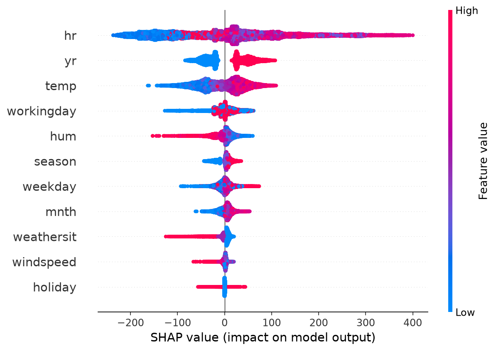
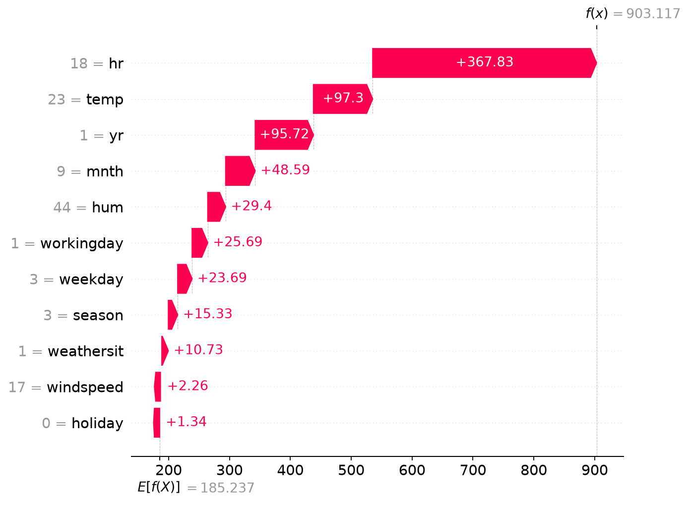
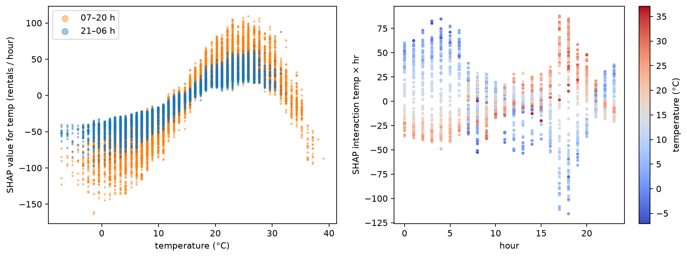
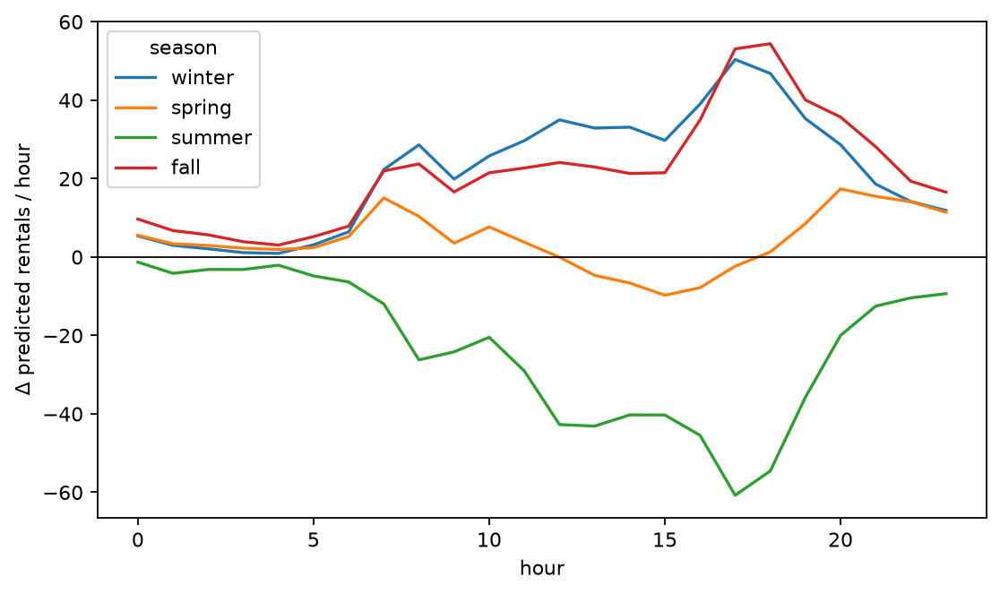
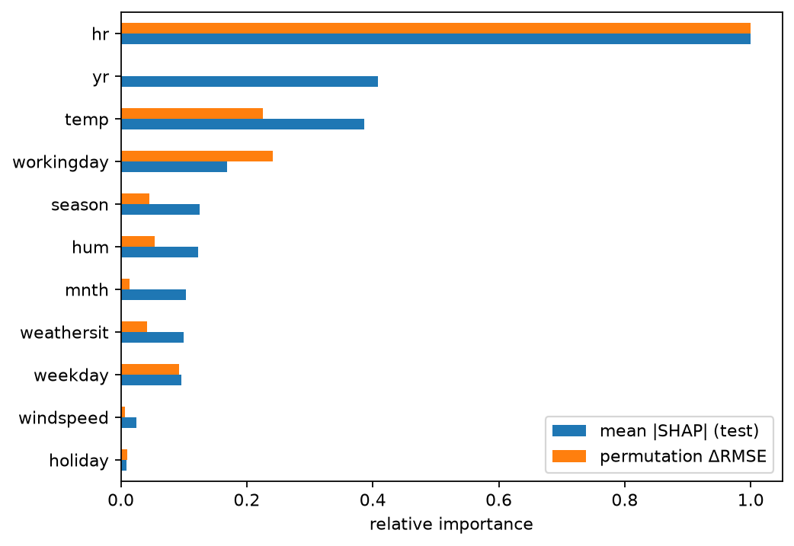
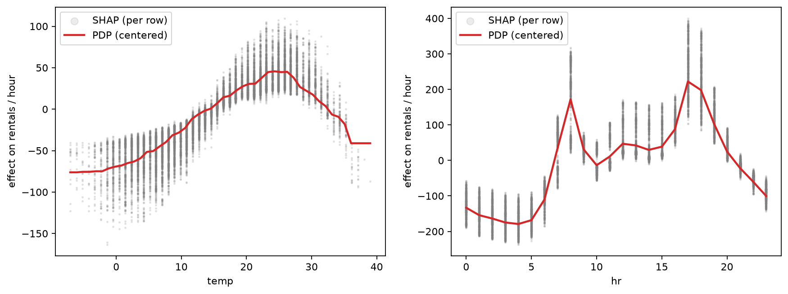

# explainable-bike-demand

Hourly bike-sharing demand forecasts with LightGBM, explained prediction by prediction with SHAP.

[](https://explainable-bike-demand-58qeuvnqszzn3gzr3l5v2l.streamlit.app/)

**[Try the live app](https://explainable-bike-demand-58qeuvnqszzn3gzr3l5v2l.streamlit.app/):** change weather, date and hour, and watch the forecast and its explanation update.

<table>
<tr>
<td></td>
<td></td>
</tr>
<tr>
<td align="center">What drives demand across all 17,379 hours</td>
<td align="center">Why the model expects 903 rentals on Wed 12 Sep 2012, 18:00 (actual: 977)</td>
</tr>
</table>

## Results

Test period: 2012-10-01 to 2012-12-31, never seen during training or early stopping.

| Model | RMSE | MAE | R² |
|---|---:|---:|---:|
| Mean per hour × working day | 119.6 | 80.0 | 0.648 |
| LightGBM | **62.6** | **39.4** | **0.904** |

## What the model learned

- **The hour matters most.** On working days, demand peaks at 8:00 and 17:00–18:00, when people commute. On weekends the curve is a single broad hump around midday.
- **Warmth helps up to about 25 °C, then hurts.** Above 30 °C the model expects fewer rentals again.
- **Warmth mostly matters during the day.** The gap between a cold and a warm hour is largest at the evening commute and much smaller at night, when few people ride anyway.
- **Rain is costly.** On a rainy Sunday afternoon in July 2012, rain alone lowers the forecast by about 45 rentals and the 35 °C heat by another 32.
- **Usage grew strongly from 2011 to 2012.** The model treats the year as a growth level. It cannot predict how fast growth will continue after 2012.
- **"5 °C warmer" depends on the season.** In winter and fall it adds about 22 rentals per hour, in summer it removes about 23, because hot days get too hot.

<table>
<tr>
<td></td>
<td></td>
</tr>
</table>

## Comparing explanation methods



- **Hour, temperature and weekday** rank similarly under SHAP and permutation importance.
- **Year** ranks second by SHAP but scores zero by permutation importance. Every test hour is in 2012, so shuffling the year within the test set changes nothing. SHAP compares against the average over both years.
- **Working day** is more important under permutation importance. Its effect lives almost entirely in the interaction with the hour (the strongest pair in the model). SHAP splits that interaction between both features, while permutation removes it entirely.
- **Partial dependence** follows the mean of the SHAP values for temperature and hour. Above about 36 °C the curve is flat because there is almost no data, so that part is extrapolation, not learned behavior.



## Caveats

- **Correlated features share credit.** Month and season correlate at 0.83 (Spearman). Their SHAP values split one underlying effect between them, so neither should be read in isolation. Feeling temperature (`atemp`) was dropped for the same reason.
- **SHAP explains the model, not the world.** A positive SHAP value for temperature means the model raises its forecast. It does not prove that warmer weather causes more rentals.
- **No forecasting beyond 2012.** The year feature only knows 2011 and 2012.

## Method

- **Data:** [UCI Bike Sharing Dataset](https://archive.ics.uci.edu/dataset/275/bike+sharing+dataset), hourly, Washington D.C., 2011–2012, downloaded on first use. Temperature, humidity and wind are converted back to °C, % and km/h. `casual` and `registered` are excluded because they sum to the target.
- **Target:** raw rentals per hour, so every SHAP value reads directly as "bikes per hour".
- **Validation:** time-based split. Train on 2011-01 to 2012-06, early stopping on 2012-07 to 2012-09, refit on both, test on 2012-10 to 2012-12.
- **Explanations:** exact TreeSHAP for all hours, SHAP interaction values on a 2,000-hour sample, permutation importance (5 repeats) on the test set, and partial dependence on a 2,000-hour background.

## Quickstart

```bash
uv sync
uv run python -m ipykernel install --user --name explainable-bike-demand --display-name "explainable-bike-demand (3.12)"
uv run python -m bike_demand.train
uv run streamlit run app/streamlit_app.py
```

The notebook `notebooks/explain.ipynb` uses the `explainable-bike-demand (3.12)` kernel and writes all figures to `reports/figures/`.

## Structure

```
src/bike_demand/   data loading, features, training
notebooks/         global + local explanations, PI/PDP comparison, what-if
app/               Streamlit app: adjust weather and time, see forecast and waterfall live
model/             trained model + test metrics
reports/figures/   figures used in this README
```

## License

MIT
